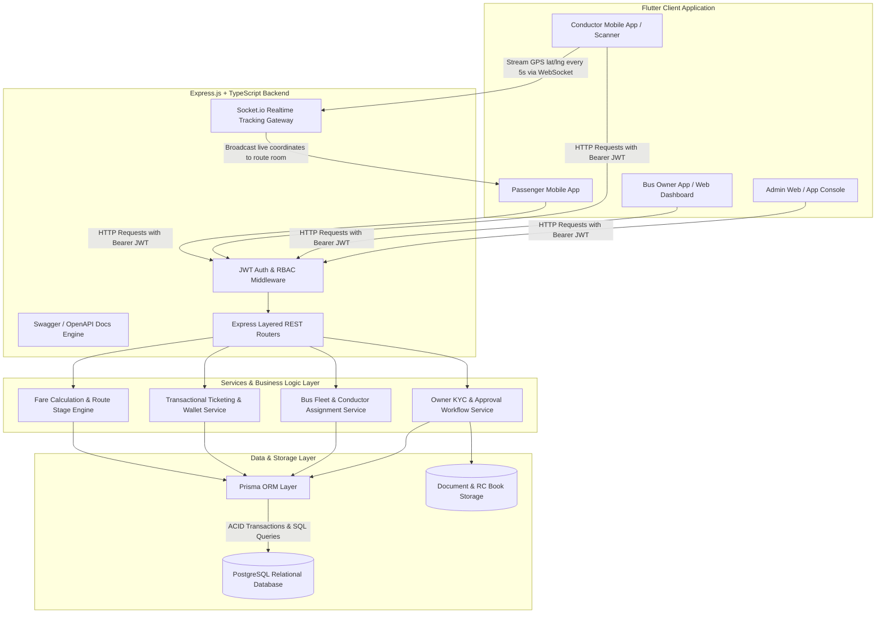

# Functional Requirements Document (FRD)
## Project: SmartBus Kerala — Smart Public Transportation Management & Digital Ticketing System

**Document Version:** 2.0.0  
**Project Type:** Final-Year Degree Project (B.Tech / MCA / B.Sc Computer Science)  
**Target Domain:** Kerala Private Bus Transport Network  
**Technology Stack:** Flutter (Frontend Mobile/Web) + Express.js & TypeScript (Standalone Backend) + PostgreSQL with Prisma ORM + Socket.io (Real-Time Live GPS)  
**Status:** Approved Baseline (100% Free & Open-Source Stack)  

---

## 1. Executive Summary & Purpose

The **SmartBus Kerala** platform is a mobile-first digital ecosystem engineered to modernize, streamline, and audit day-to-day operations of private stage-carriage line buses operating across the State of Kerala, India.

Unlike long-distance inter-city reservation systems (e.g., KSRTC SWIFT, RedBus), Kerala's private bus sector operates on a **hop-on/hop-off (spot ticketing)** operational model where:
1. Passengers board buses along dynamic fare stages without prior seat bookings.
2. Conductors issue physical paper tickets while moving down the aisle.
3. Bus owners coordinate fleet, crew shifts, daily collection reconciliations, and regulatory permits manually.
4. Passengers lack real-time bus arrival visibility and centralized ticket/expense histories.

SmartBus Kerala bridges this operational gap by deploying a 4-role coordinated platform with **QR-based passenger identification**, **in-journey rapid ticketing**, **dynamic stage-based automated fare computation**, **demonstration digital wallet / cash / UPI payment recording**, and **conductor-device-driven live GPS tracking via WebSockets**.

---

## 2. System Architecture & Topology

The system uses a **Separation of Concerns** architecture with a standalone REST & WebSocket API backend and a cross-platform client app.



---

## 3. User Personas & Role Matrix

The platform strictly enforces a **Single Primary Role per Account** architecture.

| Role Code | Role Name | Primary Interface | Core Responsibilities |
|---|---|---|---|
| `ROLE_PASSENGER` | Passenger | Flutter Mobile (Android/iOS) | Display profile QR, manage demo wallet balance, search buses/routes, view live bus tracking, inspect ticket history, submit feedback. |
| `ROLE_CONDUCTOR` | Bus Employee / Conductor | Flutter Mobile (Android with Camera & GPS) | Start/End operational trips, continuous GPS broadcasting, scan passenger QR code, select boarding/destination stops, collect fare (Wallet/Cash/UPI), issue digital ticket. |
| `ROLE_OWNER` | Bus Owner | Flutter Mobile / Tablet / Web | Submit ownership KYC & permits, register bus fleet, onboard & assign conductors, configure bus-specific route stages & timetables, inspect daily revenue collections & analytics. |
| `ROLE_ADMIN` | System Administrator | Flutter Web / Desktop / Mobile | Review owner verification requests, audit system logs, disable fraudulent accounts, monitor route metrics, broadcast system-wide passenger/crew announcements. |

---

## 4. Module-by-Module Functional Requirements

### 4.1 Module 1: Authentication & Role-Based Access Control (RBAC)

* **FR-1.1 Account Registration:**
  * System shall allow users to register with `Email`, `Password`, `Full Name`, and `Phone Number`.
  * User can register as `Passenger` or `Owner`. Conductor accounts are provisioned exclusively via Owner invitations; Admin accounts are seeded in database.
* **FR-1.2 Password Hashing & JWT Security:**
  * Passwords must be hashed using `bcrypt` (minimum 10 salt rounds).
  * System issues a signed JWT (`accessToken`) containing `userId` and `role`.
* **FR-1.3 Role Guards:**
  * Express middleware (`requireRole(['ROLE_OWNER', 'ROLE_ADMIN'])`) guards sensitive endpoints.
* **FR-1.4 Profile Management:**
  * Users can retrieve and update their profile through `GET /api/auth/me` and `PUT /api/auth/profile`.

---

### 4.2 Module 2: Passenger Profile & Dynamic QR Identification

* **FR-2.1 Unique Opaque Identifier:**
  * Every passenger account receives an immutable `passengerId` (UUIDv4).
* **FR-2.2 Privacy-Preserving QR Code:**
  * The Passenger QR Code displayed on-screen shall encode **only** an opaque passenger token:  
    `{"v": 1, "pid": "b1f83b2a-7d4e-4f51-b84a-9c71a36e92ef", "sig": "sha256_hash"}`.
  * No PII (Name, Phone, Email, Wallet Balance) is embedded inside the QR payload.
* **FR-2.3 Conductor Resolution Endpoint:**
  * When scanned by an authenticated conductor on an active trip, the backend endpoint `POST /api/tickets/verify-passenger` validates the QR token and returns basic passenger details (Name, Profile Thumbnail, Concession eligibility).

---

### 4.3 Module 3: Bus Owner Verification & Fleet Management

* **FR-3.1 Owner KYC Submission:**
  * Newly registered owners receive status `PENDING_VERIFICATION`.
  * Owner uploads identity proof and Bus Operator License via multipart form upload (`/api/owner/kyc`).
* **FR-3.2 Administrative Approval Gate:**
  * Fleet and trip features remain locked until an Administrator approves the account via `PUT /api/admin/owners/:id/approve`.
* **FR-3.3 Bus Registration & Plate Normalization:**
  * Owner registers bus with: Registration Number (e.g., `KL 07 CD 4589`), Bus Name, Type (`Ordinary`, `LSFP`, `Fast Passenger`), Seating Capacity.
  * System normalizes plate strings to uppercase without spaces (`KL07CD4589`) and enforces a PostgreSQL `UNIQUE` constraint to prevent duplicate vehicle registration.
* **FR-3.4 Bus Document Storage:**
  * Store RC Book, Route Permit Certificate, and Fitness Certificate.

---

### 4.4 Module 4: Conductor Management & Bus Assignment

* **FR-4.1 Conductor Provisioning:**
  * Bus Owners onboard conductors by providing their Name, Mobile, and Employee Code.
  * System creates an employee record with `ROLE_CONDUCTOR` linked to the owner's ID.
* **FR-4.2 Bus Assignment Binding:**
  * An owner assigns an active conductor to one bus at a time.
  * Conductor login provides access strictly to their assigned vehicle and routes.

---

### 4.5 Module 5: Route, Stop Ordering & Fare Calculation Engine

* **FR-5.1 Route & Ordered Stops:**
  * Route contains ordered sequential fare stages ($S_1 \rightarrow S_2 \rightarrow \dots \rightarrow S_n$).
  * Each stop specifies: `stopId`, `stopName`, `stageIndex` (1-indexed), `latitude`, `longitude`.
* **FR-5.2 Stop Ordering Validation:**
  * Backend asserts destination stage index is greater than boarding stage index:
    $$\text{stageIndex}(S_{\text{destination}}) > \text{stageIndex}(S_{\text{boarding}})$$
* **FR-5.3 Stage Fare Formula:**
  * Computes fare based on Kerala standard stage tariffs:
    $$\text{Fare} = \text{BaseFare} + \max(0, (\text{destinationStage} - \text{boardingStage} - \text{baseStages})) \times \text{RatePerStage}$$
  * All calculations occur authoritatively on the Express backend (`POST /api/routes/calculate-fare`).

---

### 4.6 Module 6: Trip Management & Socket.io Live GPS Tracking

* **FR-6.1 Trip Lifecycle:**
  * States: `SCHEDULED` $\rightarrow$ `IN_TRANSIT` $\rightarrow$ `COMPLETED` / `CANCELLED`.
* **FR-6.2 Real-time Geolocation Streaming (Socket.io):**
  * Conductor starts trip $\rightarrow$ connects to Socket.io namespace `/tracking`.
  * Emits event `trip:location_update` every 5 seconds with `{ tripId, latitude, longitude, bearing, speed }`.
  * Server broadcasts to room `trip_<tripId>`: `bus:location_changed`.
  * Passengers on the live map receive coordinates in real time.
* **FR-6.3 Stale Signal Detection:**
  * If no location ping is received for $> 90$ seconds, backend marks tracking status as `SIGNAL_LOST`.

---

### 4.7 Module 7: In-Journey Spot Ticketing via QR Scanning

* **FR-7.1 Conductor QR Scanning:**
  * Conductor camera scans passenger QR code in $< 500\text{ms}$.
* **FR-7.2 Boarding Stop Detection:**
  * System detects closest route stop based on current GPS coordinates.
* **FR-7.3 Instant Ticket Generation:**
  * Conductor selects destination stop, passenger count, and payment mode (`WALLET`, `CASH`, `UPI`).
  * Backend generates digital ticket with unique reference ID (e.g., `SBK-20261018-0042`).

---

### 4.8 Module 8: Passenger Demo Wallet & ACID Ledger

* **FR-8.1 Demo Wallet Provisioning:**
  * Every passenger account receives a demo wallet initialized with ₹250 test balance.
* **FR-8.2 Top-Up Simulation:**
  * Passengers can top up demo balance (₹50, ₹100, ₹200, ₹500) via `POST /api/wallet/recharge`.
* **FR-8.3 ACID Transaction Guarantee:**
  * When payment method is `WALLET`, the Express service executes an atomic Prisma transaction:
    ```typescript
    await prisma.$transaction(async (tx) => {
      const wallet = await tx.wallet.findUnique({ where: { passengerId } });
      if (wallet.balance < fareAmount) throw new Error("INSUFFICIENT_FUNDS");
      await tx.wallet.update({
        where: { passengerId },
        data: { balance: { decrement: fareAmount } }
      });
      await tx.transaction.create({ data: { walletId: wallet.id, amount: -fareAmount, type: 'TICKET_DEBIT' } });
      return await tx.ticket.create({ data: ticketPayload });
    });
    ```
* **FR-8.4 Cash & UPI Recording:**
  * Conductor cash collection is recorded on the trip ledger for end-of-day reconciliation.
  * UPI generates Kerala bus standard UPI payment intent string (`upi://pay?pa=...`).

---

## 5. PostgreSQL Relational Schema (Prisma)

```prisma
enum Role {
  ROLE_PASSENGER
  ROLE_CONDUCTOR
  ROLE_OWNER
  ROLE_ADMIN
}

enum AccountStatus {
  ACTIVE
  PENDING_VERIFICATION
  SUSPENDED
}

enum TripStatus {
  SCHEDULED
  IN_TRANSIT
  COMPLETED
  CANCELLED
}

enum PaymentMethod {
  WALLET
  CASH
  UPI
}

model User {
  id           String        @id @default(uuid())
  email        String        @unique
  passwordHash String
  fullName     String
  phoneNumber  String        @unique
  role         Role          @default(ROLE_PASSENGER)
  status       AccountStatus @default(ACTIVE)
  createdAt    DateTime      @default(now())
  updatedAt    DateTime      @updatedAt

  wallet       Wallet?
  ownerProfile OwnerProfile?
  tickets      Ticket[]
}

model OwnerProfile {
  id                 String   @id @default(uuid())
  userId             String   @unique
  user               User     @relation(fields: [userId], references: [id])
  operatorName       String
  idProofUrl         String?
  permitDocUrl       String?
  isVerified         Boolean  @default(false)
  buses              Bus[]
}

model Bus {
  id              String      @id @default(uuid())
  regNumber       String      @unique
  busName         String
  busType         String
  seatingCapacity Int
  ownerId         String
  owner           OwnerProfile @relation(fields: [ownerId], references: [id])
  trips           Trip[]
}

model Route {
  id             String      @id @default(uuid())
  routeNumber    String
  sourceName     String
  destName       String
  baseFare       Float       @default(10.0)
  farePerStage   Float       @default(1.5)
  stops          RouteStop[]
  trips          Trip[]
}

model RouteStop {
  id         String @id @default(uuid())
  routeId    String
  route      Route  @relation(fields: [routeId], references: [id])
  stopName   String
  stageIndex Int
  latitude   Float
  longitude  Float
}

model Trip {
  id               String     @id @default(uuid())
  busId            String
  bus              Bus        @relation(fields: [busId], references: [id])
  routeId          String
  route            Route      @relation(fields: [routeId], references: [id])
  conductorId      String
  status           TripStatus @default(SCHEDULED)
  currentLatitude  Float?
  currentLongitude Float?
  currentBearing   Float?
  lastGpsPing      DateTime?
  startedAt        DateTime?
  completedAt      DateTime?
  tickets          Ticket[]
}

model Ticket {
  id               String        @id @default(uuid())
  ticketNumber     String        @unique
  passengerId      String
  passenger        User          @relation(fields: [passengerId], references: [id])
  tripId           String
  trip             Trip          @relation(fields: [tripId], references: [id])
  boardingStop     String
  destinationStop  String
  boardingStage    Int
  destinationStage Int
  fareAmount       Float
  paymentMethod    PaymentMethod
  issuedAt         DateTime      @default(now())
}

model Wallet {
  id           String        @id @default(uuid())
  userId       String        @unique
  user         User          @relation(fields: [userId], references: [id])
  balance      Float         @default(250.0)
  updatedAt    DateTime      @updatedAt
  transactions Transaction[]
}

model Transaction {
  id          String   @id @default(uuid())
  walletId    String
  wallet      Wallet   @relation(fields: [walletId], references: [id])
  amount      Float
  type        String
  description String
  createdAt   DateTime @default(now())
}
```

---

## 6. Non-Functional & Viva Standards

* **100% Free & Open-Source:** No cloud subscription fees. Runs seamlessly on local development environments or free hosting.
* **Interactive API Documentation:** Built-in Swagger UI at `http://localhost:5001/api-docs` for real-time endpoint testing during the project viva.
* **High-Contrast Conductor Interface:** Large touch targets designed for single-thumb operations in a moving bus.
