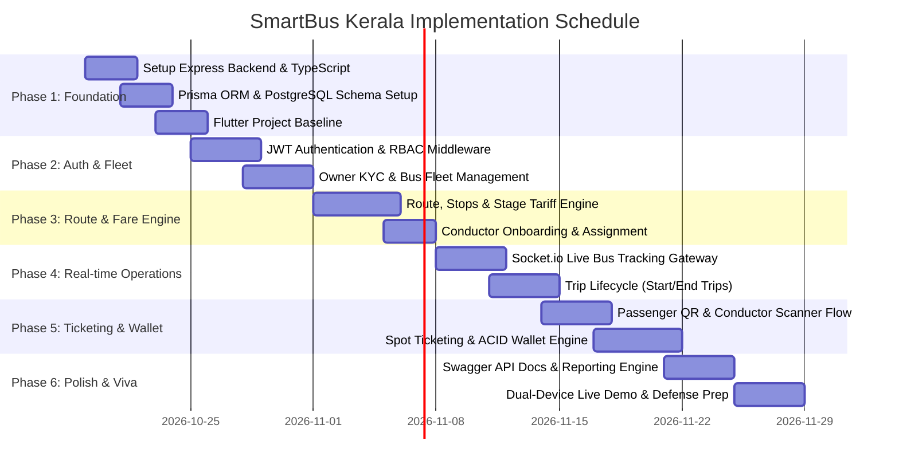

# SmartBus Kerala — Engineering Implementation Plan & Roadmap

**Target Project:** Final-Year Degree Project (Computer Science & Engineering / Information Technology)  
**Architecture:** Standalone Express.js + TypeScript Backend (PostgreSQL + Prisma + Socket.io) + Clean Architecture Flutter Client  
**Cost:** **100% Free & Open-Source (Zero Cloud Subscription Fees)**  
**Target Completion:** 8 Milestones (Structured Sprints)  

---

## 1. Stack Confirmation & Verification (100% Free & Open-Source)

Every single tool and library used in this project is completely **free and open-source**:
* **Frontend:** Flutter SDK (Free, Open Source by Google)
* **Backend:** Node.js + Express.js + TypeScript (Free, Open Source)
* **Database:** PostgreSQL + Prisma ORM (Free, Open Source; runs locally or on free cloud tiers)
* **Real-time Live Tracking:** Socket.io WebSockets (Free, Open Source)
* **API Documentation:** Swagger UI Express (Free, Open Source)
* **Maps & Geolocation:** `geolocator` + OpenStreetMap / Google Maps (Zero cost on developer tier)

---

## 2. Directory Architecture

```
smartbus_kerala/
├── backend/                       # Standalone Node.js + Express.js + TypeScript
│   ├── prisma/
│   │   ├── schema.prisma          # PostgreSQL models (Users, Buses, Routes, Trips, Tickets, Wallets)
│   │   └── migrations/
│   ├── src/
│   │   ├── config/                # Environment variables, DB connection, JWT secrets
│   │   ├── middlewares/           # JWT auth, role validation, error handling
│   │   ├── routes/                # auth, bus, route, trip, ticket, wallet, admin routes
│   │   ├── controllers/           # HTTP Request & Response handlers
│   │   ├── services/              # Fare calculation, ACID wallet debits, trip management
│   │   ├── sockets/               # Socket.io GPS broadcast gateway
│   │   ├── docs/                  # Swagger OpenAPI spec (/api-docs)
│   │   └── server.ts              # Express + Socket.io entry point
│   ├── package.json
│   └── tsconfig.json
│
├── mobile/                        # Flutter Mobile & Web Client
│   ├── lib/
│   │   ├── core/                  # Theme, Constants, Network client, Local storage
│   │   ├── features/
│   │   │   ├── auth/              # Login, Register, Role Router
│   │   │   ├── passenger/         # Dashboard, QR display, Ticket history
│   │   │   ├── conductor/         # QR scanner, Trip controller, Spot ticketing
│   │   │   ├── owner/             # Fleet manager, Conductor onboarding, Reports
│   │   │   ├── admin/             # KYC review, System health, Audit logs
│   │   │   ├── tracking/          # Live map, Bus marker, Socket.io client
│   │   │   └── wallet/            # Balance card, Demo recharge, Transactions
│   │   └── main.dart
│   └── pubspec.yaml
│
└── docs/                          # Architecture Diagrams, FRD, Presentation Slides
```

---

## 3. Step-by-Step Milestone Roadmap



---

### Milestone Breakdown

#### Milestone 1: Backend Foundation & Database Schemas
* Initialize Express.js with TypeScript (`express`, `cors`, `dotenv`, `ts-node-dev`).
* Configure Prisma with PostgreSQL database models: `User`, `OwnerProfile`, `Bus`, `Route`, `RouteStop`, `Trip`, `Ticket`, `Wallet`, `Transaction`.
* Create the HTTP + Socket.io combined server and verify health endpoint `GET /api/health`.
* Initialize Flutter application with dependency injection and core theme.

#### Milestone 2: Authentication & Role-Based Access Control (RBAC)
* Implement JWT authentication endpoints:
  * `POST /api/auth/register` (Passenger / Owner)
  * `POST /api/auth/login` (Password verification via bcrypt)
  * `GET /api/auth/me` (Profile retrieval)
* Write Express middleware: `authenticateJWT` and `requireRole(['ROLE_OWNER', 'ROLE_ADMIN', 'ROLE_CONDUCTOR', 'ROLE_PASSENGER'])`.
* Add Owner KYC document upload and Admin approval endpoint.

#### Milestone 3: Fleet Management & Sequential Route Engine
* Bus registration endpoints with Kerala plate validation regex (`KL-xx-xx-xxxx`).
* Route & Stop Manager:
  * Ordered stops ($S_1 \rightarrow S_2 \dots S_n$) with geographic coordinates.
  * Kerala stage fare calculator endpoint: `POST /api/routes/calculate-fare`.
* Conductor account creation and bus assignment endpoints.

#### Milestone 4: Trip Lifecycle & Socket.io Live GPS Tracking
* Trip lifecycle endpoints: `POST /api/trips/start` and `POST /api/trips/end`.
* Socket.io tracking gateway (`src/sockets/tracking.socket.ts`):
  * Conductors broadcast GPS: `conductor:send_location` $\rightarrow$ `{ tripId, lat, lng, bearing, speed }`.
  * Server broadcasts to passengers in room `trip_<tripId>`: `bus:location_update`.
  * Heartbeat check: Invalidate location if no coordinates received for $> 90$ seconds.

#### Milestone 5: Conductor QR Scanner & Rapid Spot Ticketing
* Passenger QR Generator in Flutter displaying privacy-preserving passenger token.
* Conductor Scanner (`mobile_scanner` in Flutter) scanning passenger QR.
* Automated nearest-stop detection using conductor's current GPS.
* Ticket creation endpoint: `POST /api/tickets/issue`:
  * Validates destination stop sequence ($S_{\text{dest}} > S_{\text{board}}$).
  * Computes fare.
  * Generates digital ticket ID (`SBK-YYYYMMDD-XXXX`).

#### Milestone 6: Demo Wallet & ACID Transactions
* Auto-provision passenger demo wallet with ₹250 initial credit.
* Demo top-up endpoint: `POST /api/wallet/recharge`.
* Atomic wallet deduction using Prisma `$transaction` to ensure balance cannot be overdrawn or double-spent.
* Support for Cash and UPI recording modes.

#### Milestone 7: Analytics, Reports & Swagger Documentation
* Daily revenue and passenger collection aggregation endpoint for Bus Owners.
* Conductor shift collection reconciliation.
* Mount Swagger UI at `http://localhost:5001/api-docs` with interactive API testing.

#### Milestone 8: Dual-Device Viva Demonstration & Defense
* Comprehensive test suite verifying fare calculation, stop sequence, and atomic wallet deductions.
* Seed database script (`npm run prisma:seed`) with realistic Kerala private bus data:
  * Route: *Aluva $\leftrightarrow$ Perumbavoor via Kizhakkambalam*.
  * 1 Admin, 1 Verified Owner, 2 Buses, 1 Conductor, 2 Test Passengers.
* Prepare demonstration workflow for viva examiners.
